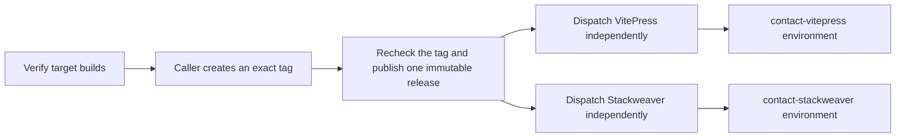

# Worker release workflow

Publish a Cloudflare Worker once per version. Select a target later to
rehearse or activate that release from a separate GitHub Actions run.

| Operation | What it does |
| --- | --- |
| `verify` | Test and bundle each allowlisted target at the checked-out commit. |
| `publish` | Reverify the exact tag and publish its immutable release assets. |
| `rehearse` | Select one published target and run the synthetic upload dry run. |
| `activate` | Select one published target and activate it after the environment approval. |

The caller repository owns the tags, releases, environments and secrets.
The reusable workflow coordinates [the CI action](https://github.com/vhco-pro/worker-ci-action)
and [the deploy action](https://github.com/vhco-pro/worker-deploy-action).

[Configure the workflow and target environments](docs/usage.md) ·
[Complete pilot caller](https://github.com/vhco-pro/vhco-contact/blob/main/.github/workflows/delivery.yml) ·
[Example immutable release](https://github.com/vhco-pro/vhco-contact/releases/tag/v0.1.0)
